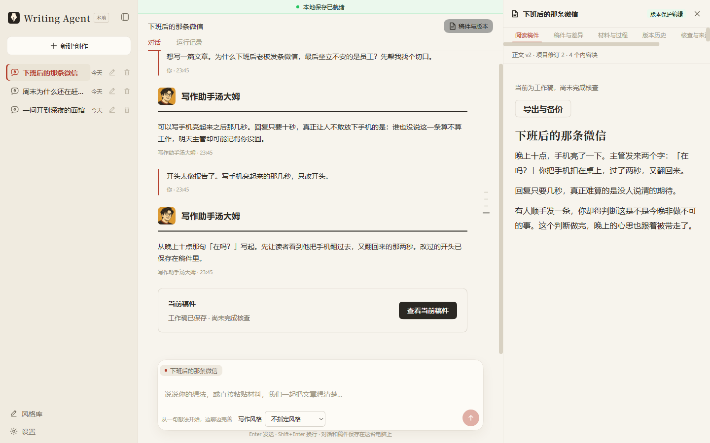

# Writing Agent · 写稿 Agent

**把一个想法，写成一篇有自己声音的文章。**

Writing Agent 是一款开源中文写作助手，适合写公众号文章、观点评论、经验分享和个人随笔。给它一句想法、一段材料或一条参考链接，先聊出一个值得写的切口。方向定了，再整理素材、写初稿，和助手一起改到你满意。

**[下载 Windows x64 桌面版 · RC117](https://github.com/dongbeixiaohuo/writing-agent/releases/download/desktop-v1.0.0-rc.117/Writing-Agent-Setup-1.0.0-rc.117-x64.exe)** · [快速上手](#desktop-start) · [Claude Code 插件](#claude-code-skill) · [文档中心](docs/README.md)



*截图来自 Windows 桌面版 RC113，内容为示例。*

<a id="desktop-app"></a>
<a id="rc-status"></a>
<a id="desktop-start"></a>

## 开始写第一篇文章

1. **安装桌面版。** 运行 Windows x64 安装包。安装说明和 SHA256 校验文件在发布页。[RC117 发布页](https://github.com/dongbeixiaohuo/writing-agent/releases/tag/desktop-v1.0.0-rc.117)
2. **连接模型。** 打开「设置 → 模型」，填写服务商的 API Key 和模型 ID 并验证连接。三个角色分组可以共用一个已验证的模型。桌面版无需另装 Claude Code、Node.js 或 Python。[配置模型](docs/QUICKSTART_1_0.md#2-配置模型)
3. **说说你想写什么。** 点击「新建创作」，输入想法，也可以直接贴材料或链接。

   > 想写一篇公众号文章。为什么下班后老板发条微信，最后坐立不安的是员工？先帮我找几个具体的切口。

4. **看稿、提意见、导出。** 确认方向后，可以分阶段看提纲和初稿。在对话里说「开头太像报告了，写手机亮起来的那几秒，只改开头」。打开「稿件与版本」查看修改、恢复旧版本。选定标题并完成核查后，可以导出 TXT 或 HTML。

## 写作时，你能决定什么

- **从哪个角度写。** 还没想好时，先和助手讨论给谁看、想说什么。你可以选一个切口，也可以用自己的话定方向。
- **用什么口吻写。** 把喜欢的样文粘贴进来、导入 TXT / Markdown / DOCX，或读取公开网页。可把提取出的结构、节奏和表达习惯保存到风格库，按篇选用。
- **哪些地方值得改。** 初稿出来后，可以参考审校和模拟读者的反馈，在对话里决定改哪里、保留哪些表达。历史稿件保存在对应会话中。

## 看看初稿和改稿差在哪里

仓库保留了《工资的一半，是你受的气折算的》的 Claude Code 写作示例。想快速看效果，可以先读同一篇文章的[初稿](demo/工资的一半，是你受的气折算的/draft_v1.md)和[打磨后的版本](demo/工资的一半，是你受的气折算的/draft_v1_humanized.md)。

想看文章是怎么想出来的，可以回到[选题](demo/工资的一半，是你受的气折算的/01_theme.md)、[素材记录](demo/工资的一半，是你受的气折算的/02_evidence_ledger.json)和[提纲](demo/工资的一半，是你受的气折算的/03_outline.md)。

<a id="claude-code-skill"></a>

## 在 Claude Code 中使用

如果你已经用 Claude Code 管理本地稿件，可以把 Writing Agent 安装成插件。选题、材料、提纲、初稿和审校结果会按文章保存在目录里。

```sh
claude plugin marketplace add dongbeixiaohuo/writing-agent
claude plugin install writing-agent@writing-agent-marketplace
```

在准备写作的目录中启动 Claude Code，直接说你想写什么。插件需要可用的 Claude Code、Node.js 和 Python。[安装与使用指南](docs/CLAUDE_CODE_GUIDE.md) · [与桌面版的功能对照](docs/DESKTOP_SKILL_COMPARISON.md)

## 模型、搜索与本地数据

桌面版支持常用模型服务的预设，也能连接自定义 API 或兼容的本地网关。可以全程用一个模型，也可以为不同写作角色选模型。搜索服务可在设置里开关。[模型和搜索设置](docs/QUICKSTART_1_0.md#2-配置模型)

会话、参考材料和稿件保存在本机。写作需要的上下文会发往你配置的模型服务，使用外部搜索时会把检索词发送给启用的搜索服务。服务用量和费用按对应服务商的规则计算。

<a id="development"></a>

## 本地开发与贡献

使用 Node.js 24.18.0 和 Python 3.11。可以先用示例数据启动界面，无需配置模型服务。

```sh
git clone https://github.com/dongbeixiaohuo/writing-agent.git
cd writing-agent
npm ci
npm run ui:dev:mock
```

| 目录 | 内容 |
|---|---|
| `apps/desktop`、`apps/web` | 桌面入口与 Web 界面 |
| `packages/` | 写作流程、模型适配、存储与界面组件 |
| `claude-runtime/` | Claude Code Skill 与专家工作流维护源 |
| `demo/`、`evaluations/` | 写作样例与质量评估工具 |

运行检查可用 `npm run check:runtime`、`npm run check:ui`、`npm run check:desktop`。Windows 打包使用 `npm run desktop:package`，产物位于 `output/desktop`。[项目结构](docs/PROJECT_STRUCTURE.md) · [开发与发布文档](docs/README.md) · [更新记录](CHANGELOG.md)

欢迎告诉我们哪一段让你读不下去、哪一句不像你的口吻，或者哪条改稿意见确实帮到了你。反馈时请带上版本和复现步骤，并删去私人信息和 API Key。[提交 Issue](https://github.com/dongbeixiaohuo/writing-agent/issues)

## 开源与致谢

Writing Agent 采用 [MIT License](LICENSE)。感谢参与写作测试的用户，以及 [CC-Switch](https://github.com/farion1231/cc-switch) 等提供参考的开源项目。[第三方声明](THIRD_PARTY_NOTICES.md)
