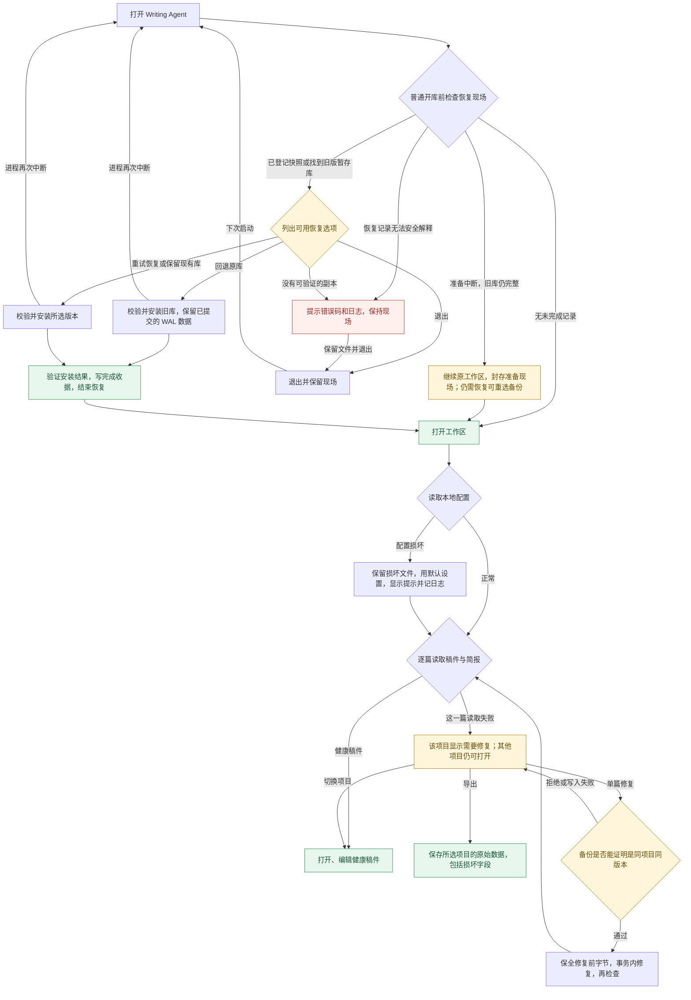

# 第一批施工验收 · 启动与恢复

2026-11-21。范围为整库恢复中断、单篇稿件或简报损坏、外观等配置损坏。实现位于独立工作树 `codex/batch1-startup-recovery`。基线为 `b52a223`，其文件树与 RC102 发布提交 `9628676` 相同。

## 可以怎样判断是否修好

| 同一操作 | RC102 实际表现 | 第一批实际表现 |
| --- | --- | --- |
| 将旧库留在旧版恢复暂存名，主库尚未就位，重新打开 | 桌面启动成功，却新建了空库，之前的文章从列表消失 | 普通开库被拦住，原文件就地保留。选择回退后读到原有文章。新流程中已有完整目标副本时，也可按“重试恢复”读到备份中的文章 |
| 在两篇稿件中只破坏一篇的简报，或只破坏一篇的正文字段 | 创建整个工作区界面时抛出 JSON 解析异常，另一篇健康稿也进不去 | 健康稿可读、可改；坏稿仍有自己的项目卡片，提示具体读取环节。点它不会把写作命令发给健康稿 |
| 让外观、搜索或模型配置 JSON 各自在中间截断 | 分别在载入对应配置时中止启动 | 三种故障均保全原件并照常进入工作区。外观回到纸张主题、14 号字，搜索关闭，模型显示待配置。界面说明副本位置，可以重新设置 |
| 配置路径被同名目录占用 | 整个应用启动失败 | 原路径保持原样，应用启动并提示检查权限或占用。该项配置在本次启动期间禁止覆盖 |
| 在问题项目中选择用备份修复 | RC102 没有这个单篇入口 | 先用坏备份，看到“备份文件未通过检查”，原稿仍在；再选择匹配备份，只修复所选项目。真实桌面测试读回了另一篇稿件的原文 |

## 启动与恢复状态图

绿色是可继续工作的状态。黄色需要作者作选择。红框是检测到证据不足时有提示、有日志的保护性停止。遇到红框时会保留文件供人工核对。



## 数据和日志留在哪里

- **整库恢复。** 桌面在准备安全备份前先登记现场。开始替换前将旧库和新库各做成可独立打开的 SQLite 快照，记录 SHA-256。恢复安装时先校验所选快照，安装后再校验，最后写完成收据并撤下活动记录。重试时可以使用已经验证的本地快照。原备份文件后来被移走，也有对应的回归测试。
- **旧版本留下的现场。** 若旧库与后来继续写过的现库同时存在，工具允许保留现库，或保全现库后回到旧库。副本和封存现场分开保存在工作区的 `.writing-agent/restore-recovery-*` 与 `.writing-agent/restore-evidence-*`。正常恢复入口仍会写一份 `.writing-agent/restore-backups` 安全备份。启动恢复对话显示本机 `startup-errors.jsonl` 路径。
- **配置。** 损坏原件以 `原名.invalid-唯一编号.bak` 保存在原目录。读取受阻或无法保留副本时，保留原位置并阻止覆盖。诊断写入 `.writing-agent/logs/settings-recovery.jsonl`，仅记录文件名、错误码和副本名。若日志也无法写入，界面会告知，进程日志仍输出脱敏错误。
- **单篇修复。** “导出此项目原始数据”选择保存位置，仅导出所选项目。原始包保留当前简报与正文结构的 SQLite 字段字节。若选择“从备份修复此项目”，先核对项目、当前版本、内容或哈希和必要的元数据；将修前记录及原字节保存至 `.writing-agent/project-repairs`，再用事务修复损坏字段。无匹配版本、简报整行丢失且无本地哈希、备份也坏、取证文件写不进去，都会拒绝写入。既有健康版本以及其他项目保持原状。
- **单篇诊断。** `.writing-agent/project-diagnostics` 使用按项目区分的文件。即使该诊断文件不能写，也会提示用户并记录到进程日志，仍可导出问题项目。重新检查用于重新读取现场；整库还原另有入口及对所有项目影响的明确提示。

## 自动化回归与复跑

在本工作树根目录、仓库匹配的 Node 和已安装依赖下执行。验收使用 Windows、Node 24.18.0、Electron 44.0.0。SQLite 全部使用临时目录及合成数据。桌面自动化使用编译后的 main、preload 和 React 界面，原生对话框由测试选择按钮或文件位置。

```powershell
npm run test:startup-recovery
npm run test:startup-recovery:desktop
```

用下列命令可重复跑修复前后完全相同的 7 个断言。本次旧版对照使用 RC102 源码快照，只复制了这两个测试文件并使用同一套依赖。

```powershell
node --import tsx --test --test-reporter=spec --test-name-pattern="legacy interrupted restore blocks|startup preserves damaged|unreadable settings path|genuine two-project" apps/desktop/test/startup-config-recovery.test.ts packages/client-bridge/test/project-read-isolation.test.ts
```

| 验证 | 结果 | 本地日志路径 |
| --- | --- | --- |
| 以上 7 个断言，RC102 | 0 通过，7 失败。旧库改名用例报 Missing expected rejection，坏简报与坏正文各在创建界面时异常 | `output/testing/batch1-startup/before-RC102.log` |
| 相同 7 个断言，第一批实现 | 7 通过，0 失败 | `output/testing/batch1-startup/after-same-seven.log` |
| 第一批专项 | 83 通过，0 失败，0 跳过 | `output/testing/batch1-startup/startup-recovery.log` |
| Windows Electron 正常恢复、准备期继续、回退、重试、退出，以及坏稿隔离导出与单篇修复 | 6 通过，0 失败，0 跳过 | `output/testing/batch1-startup/native-electron.log` |
| 桌面回归 | 141 通过，0 失败，0 跳过 | `output/testing/batch1-startup/regression-desktop-final.log` |
| runtime、Desktop、Web 三份类型检查 | 全部退出码 0 | `output/testing/batch1-startup/types.log` |

恢复测试在独立子进程中强制结束进程，覆盖创建准备目录、快照登记、处理 WAL 和 SHM、移除主库、安装目标以及验证完成等边界，也覆盖在回退或重试途中再次强退。断言读取实际项目和已提交的 WAL 内容。单篇测试覆盖备份已过期、匹配失败、事务中途报错后整笔回滚、重做同一修复、非法 UTF-8 原始字节，以及所有项目都坏时仍能新建。另做了既有存储、工作流、界面和桥接回归；专项和常规套件包含重叠测试，计数分别报告。

## 核心文件

| 范围 | 入口和测试 |
| --- | --- |
| 整库恢复与启动 | [恢复流程](../../apps/desktop/src/workspace-restore.ts)、[原生启动和对话框](../../apps/desktop/src/main.ts)、[启动错误与日志](../../apps/desktop/src/startup.ts)、[强退回归](../../apps/desktop/test/workspace-restore-recovery.test.ts)及[子进程夹具](../../apps/desktop/test/workspace-restore-crash.fixture.ts) |
| 数据隔离与单篇修复 | [SQLite 开库、快照、取证与修复](../../packages/storage/src/index.ts)、[逐项目读取与恢复](../../packages/application/src/index.ts)、[界面状态与命令归属](../../packages/client-bridge/src/application-bridge.ts)、[坏项目回归](../../packages/client-bridge/test/project-read-isolation.test.ts)、[单篇修复回归](../../packages/storage/test/project-repair.test.ts) |
| 配置与界面 | [配置容错与日志](../../packages/client-bridge/src/local-settings-recovery.ts)、[桌面宿主](../../apps/desktop/src/application-host.ts)、[项目卡和非阻断提示](../../packages/ui/src/shell/WritingAgentShell.tsx)、[配置回归](../../apps/desktop/test/startup-config-recovery.test.ts)、[全坏项目界面回归](../../packages/ui/test/project-read-isolation.test.ts) |
| 端到端与复跑入口 | [Electron 桌面测试](../../tests/ux/batch1-startup-desktop.test.ts)、[原生对话框测试夹具](../../apps/desktop/test/fixtures/startup-resilience-electron.cjs)、[npm 命令](../../package.json) |

本次验证的是正常操作与**进程强退**。物理断电、磁盘控制器丢写以及所有可信副本同时损毁没有实机验收。若没有足够证据，应用会说明原因并保留现场。两条独立链路分别由两名 `gpt-6-astra / high` 子 Agent 核查存储恢复和单项目隔离，主 Agent 核对交叉路径并运行桌面验收。第一批交付到此，草稿和任务取消留待下一批确认。
