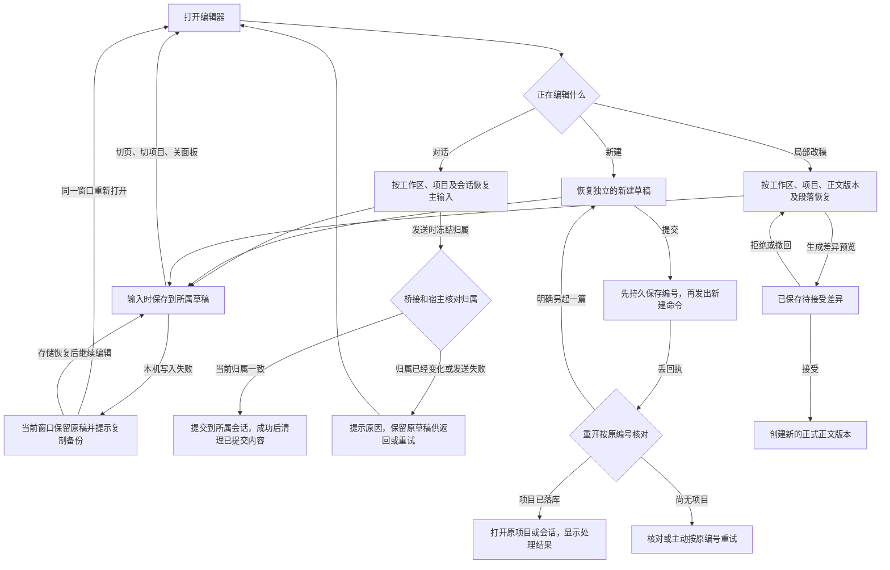
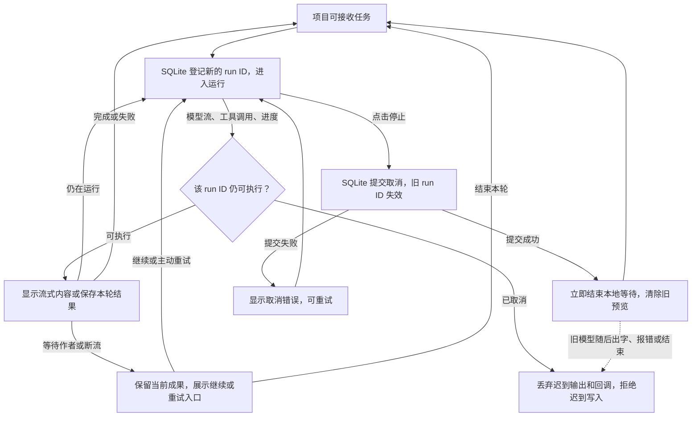

# 第二批验收 · 草稿、停止与新建回执

## 原审计的 6 项高危

| 原审计编号 | 验收状态 |
| --- | --- |
| H1 整库恢复中断，启动误建空库 | 第一批已覆盖。第二批复跑了回退、重试、准备期恢复、退出和再次强退。 |
| H2 单篇坏简报或正文阻断启动 | 第一批已覆盖。第二批复跑了坏项目隔离、健康项目打开、原始数据导出和同版本修复。 |
| H3 坏外观配置阻断启动 | 第一批已覆盖。第二批复跑了异常配置保留、默认配置启动和可见提示。 |
| H4 甲项目的输入发给乙项目 | 第二批已覆盖。按所属项目和会话恢复草稿，发送时桥接与宿主都复核归属。 |
| H5 切页或关面板丢掉未发文字 | 第二批已覆盖。输入自动暂存，局部改稿按项目、正文版本和段落分别保存。 |
| H6 点停止后，同项目被旧请求占用 | 第二批已覆盖。停止写入 SQLite 即撤销旧 run ID 的执行权，项目可立即接受新任务。 |

第一批存档为 `8c38f0f801c3f46ea06719fd87807841a0e7603e`，包含长期回归脚本。两批覆盖原报告的全部 6 项高危。M1 新建丢回执是报告中的中危，纳入第二批。M8 的模型断流卡现在说明主动重试会发出新的模型请求、可能再次计费。

## 同一组故障在 RC102 与第二批的实际表现

对照版为 RC102 `96286761b9925f51bfd7e386af3a8a7a48b69172`。两版使用同一套 Windows Electron 测试和独立临时工作区。草稿用例记录真实预加载桥接发出的目标与文本，并让过期归属进入真实宿主校验。新建和停止用例经过真实渲染器、IPC、应用服务及 SQLite，只在模型入口换成可控制返回顺序的假模型。

| 场景 | RC102 | 第二批 |
| --- | --- | --- |
| 甲输入文字，打开「运行记录」再返回，随后刷新 | `afterTab=""`，`afterReload=""` | 两次都恢复完整的未发送文字。切回后写下的新草稿也能经受上一次发送回执迟到 |
| 甲输入后切到乙并发送 | 乙框显示甲原文且发送按钮可用。实际发出的命令缺少原归属，切回甲时框内又留着乙的字 | 乙框为空且发送不可用。输入乙草稿后，发送携带乙项目与乙会话。切回甲找回甲原文。模拟过期归属被宿主以 `DRAFT_OWNER_CHANGED` 拒绝 |
| 局部改稿未生成差异预览时关面板 | 重开显示原段落，刚输入的文字丢失 | 重开恢复原段落的未接受修改。另一段独立暂存。接受差异后，新版本按新正文定位 |
| 保存草稿时浏览器存储写失败 | 新建面板沿用旧项目输入，独立草稿断言先失败 | 新建面板独立。存储失败有提示，两类草稿在当前窗口仍能随切换及重开恢复。存储恢复后继续输入即可保存 |
| 假模型无视取消，点停止后立即在同项目再发 | 旧任务库内已为 `cancelled`，第二次发送返回 `RUN_ALREADY_ACTIVE` | 旧模型仍在等待时，SQLite 同时记录旧任务 `cancelled`、新任务 `running`。放行迟到的旧文字和异常后，只有新任务转为 `completed`，界面及 SQLite 事件均无旧文字 |
| 新建和首轮已落库，回执被扣留，此时强杀 Electron | 重开并再次提交得到 2 个项目、2 个任务、2 次假模型请求 | 自动找回同一项目与会话。点击「新建项目」后仍为 1 个项目、1 个任务、1 次请求。明确点「另起一篇」并提交才创建第二个项目 |
| 只有新项目落库，首轮任务写入失败，此时丢回执并强退 | 重开后没有提示可以找回原项目及未发首句 | 重开后打开原项目并带回首句，仍为 0 次模型请求。作者手动发送后，原项目才启动第 1 个任务 |

停止专项另外验证了旧模型永久等待、迟到工具调用、错误、抛异常、另一个服务直接取消等 12 个用例。迟到正文写入即使携带当前项目版本也会被 SQLite 拒绝，原正文和旧事件保持原样，新任务的流式预览继续显示。

## 草稿归属与退出路径



## 任务取消与迟到结果



取消通过 SQLite 状态释放本地执行权。上游提供商如果忽略取消信号，仍可能继续运行或计费。新建的首次请求采用严格持久化的 IndexedDB 事务先登记编号，重开后按该编号与 SQLite 的已落库记录对账。仅项目落库时，首句搬回原项目的草稿，由作者点发送。草稿写盘失败时的内存副本只随当前窗口存活，界面会提示复制备份。强退验收使用进程终止，物理断电未做实机测试。

## 复跑入口与原始日志

在第二批工作树执行以下命令。RC102 对照使用另一个已执行 `npm run build:desktop` 的 RC102 工作树。

```powershell
npm run test:writing-recovery
npm run test:writing-recovery:desktop
npm run test:startup-recovery
npm run test:startup-recovery:desktop

$env:WA_COMPILED_ROOT = '<已构建的 RC102 工作树绝对路径>'
$env:WA_TEST_LABEL = 'rc102'
node --import tsx --test --test-concurrency=1 --test-reporter=spec tests/ux/batch2-drafts-desktop.test.ts tests/ux/batch2-requests-desktop.test.ts
Remove-Item Env:WA_COMPILED_ROOT, Env:WA_TEST_LABEL
```

| 验证 | 实测结果 | 本地日志路径 |
| --- | --- | --- |
| RC102 同脚本 Electron 对照 | 0 通过，7 失败 | `output/testing/batch2/rc102-desktop-comparison.log` |
| 第二批真实 Electron | 7 通过，0 失败 | `output/testing/batch2/batch2-desktop.log` |
| 第二批专项 | 61 通过，0 失败 | `output/testing/batch2/writing-regression.log` |
| 取消专项同脚本对照 | RC102 0/12，第二批 12/12 | `output/testing/batch2/h6-rc102-entry.log` · `output/testing/batch2/h6-fixed-entry.log` |
| 第一批专项复跑 | 83 通过，0 失败 | `output/testing/batch2/startup-rerun.log` |
| 第一批真实 Electron 复跑 | 6 通过，0 失败 | `output/testing/batch2/startup-desktop-final.log` |
| 既有运行时、桥接、对话、UI 套件 | 分别 468、162、104、125 通过 | `output/testing/batch2/runtime.log` · `output/testing/batch2/bridge-final.log` · `output/testing/batch2/conversation-rerun.log` · `output/testing/batch2/ui-final.log` |
| 既有桌面模块、流程确认套件 | 分别 141、28 通过 | `output/testing/batch2/desktop-modules.log` · `output/testing/batch2/confirmation.log` |

原始日志和各用例的 JSON 在工作树内的 `output/testing/batch2/`，由 Git 忽略。测试脚本已保存在仓库中，各套件可能覆盖同一行为，计数分别报告。

## 核心文件

| 范围 | 核心实现与测试 |
| --- | --- |
| 主输入与段落草稿 | [草稿存取](../../packages/ui/src/shell/draft-storage.ts)、[主输入与导航](../../packages/ui/src/shell/WritingAgentShell.tsx)、[局部修改](../../packages/writing-ui/src/WritingWorkbenchPanel.tsx)、[命令归属](../../packages/client-bridge/src/message-owner.ts) |
| 运行状态与取消 | [应用任务](../../packages/application/src/index.ts)、[流式输出](../../packages/runtime/agent/src/index.ts)、[SQLite 写入校验](../../packages/storage/src/index.ts)、[取消专项](../../packages/application/test/cancellation-resilience-entry.test.ts) |
| 新建回执、断流提示 | [持久回执](../../packages/ui/src/shell/conversation-creation.ts)、[应用桥接](../../packages/client-bridge/src/application-bridge.ts)、[断流提示](../../packages/ui/src/shell/interaction.ts)、[桥接重开对照](../../packages/client-bridge/test/conversation-intake.test.ts) |
| 真实桌面验收 | [草稿测试](../../tests/ux/batch2-drafts-desktop.test.ts)、[新建和停止测试](../../tests/ux/batch2-requests-desktop.test.ts)、[npm 脚本](../../package.json) |

两个独立子任务分别用 `gpt-6-astra / high` 验证草稿归属和任务取消，选用该档位是因为两项都跨界面、桥接或运行时与存储。主 Agent 完成新建回执及整体验收。
